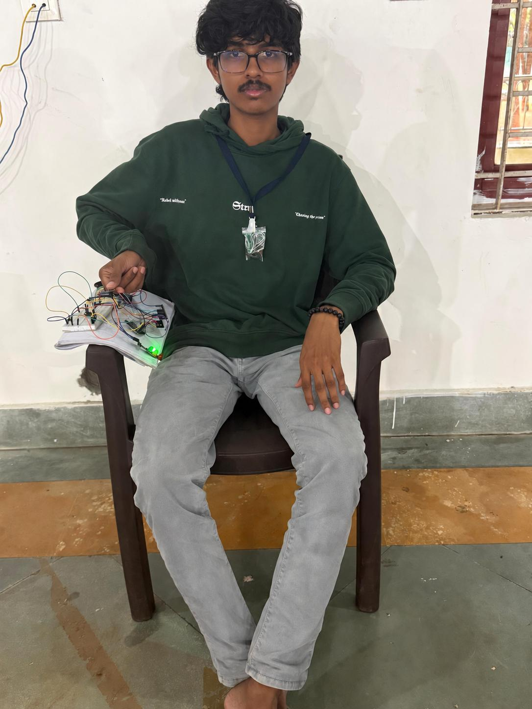
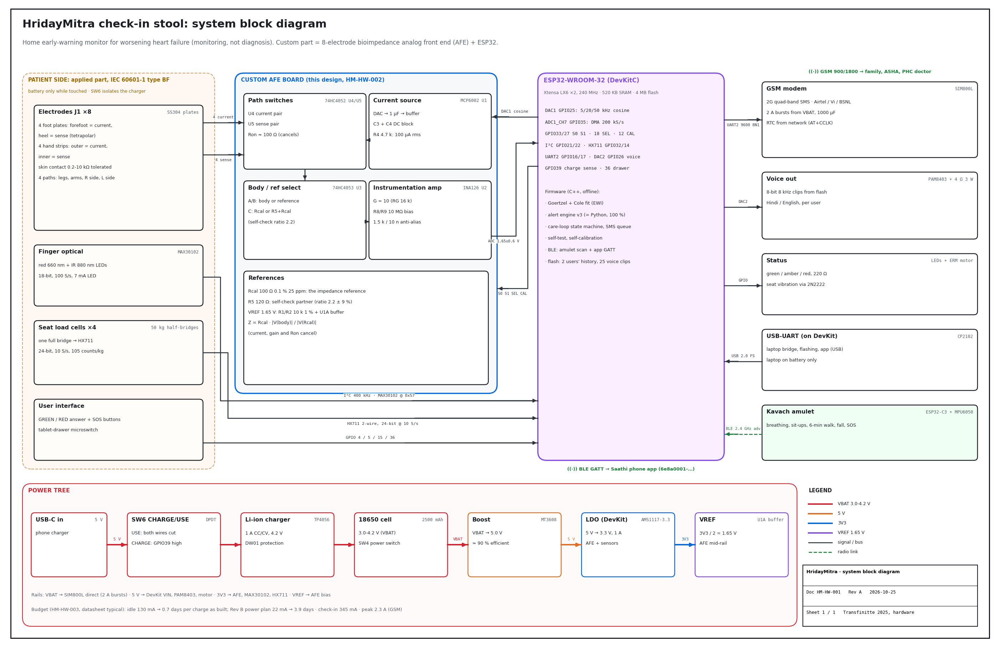
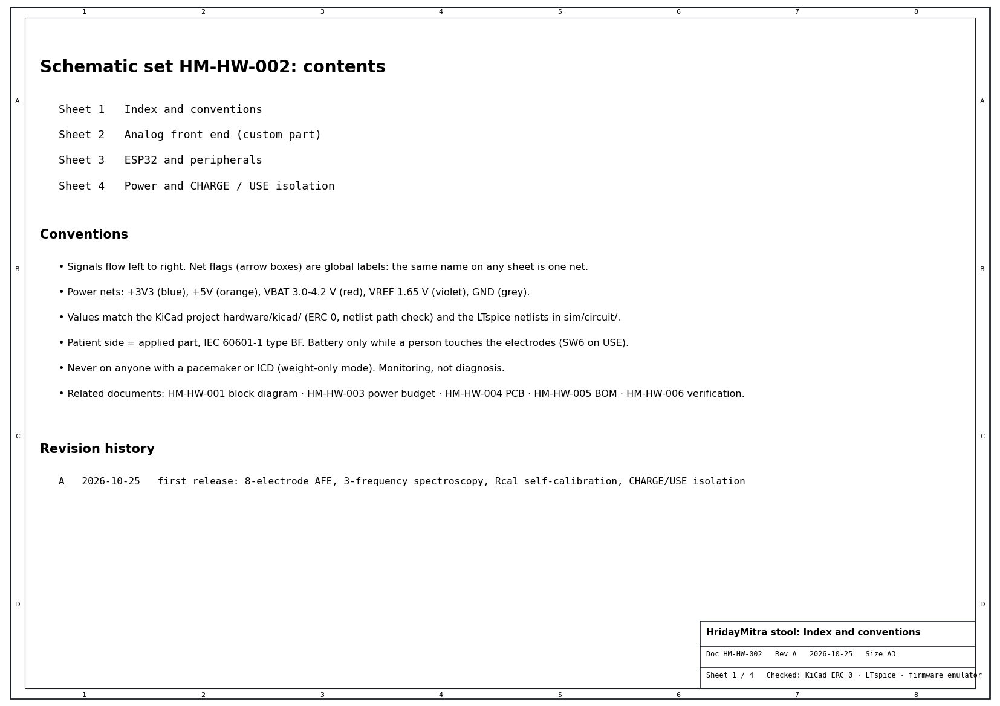
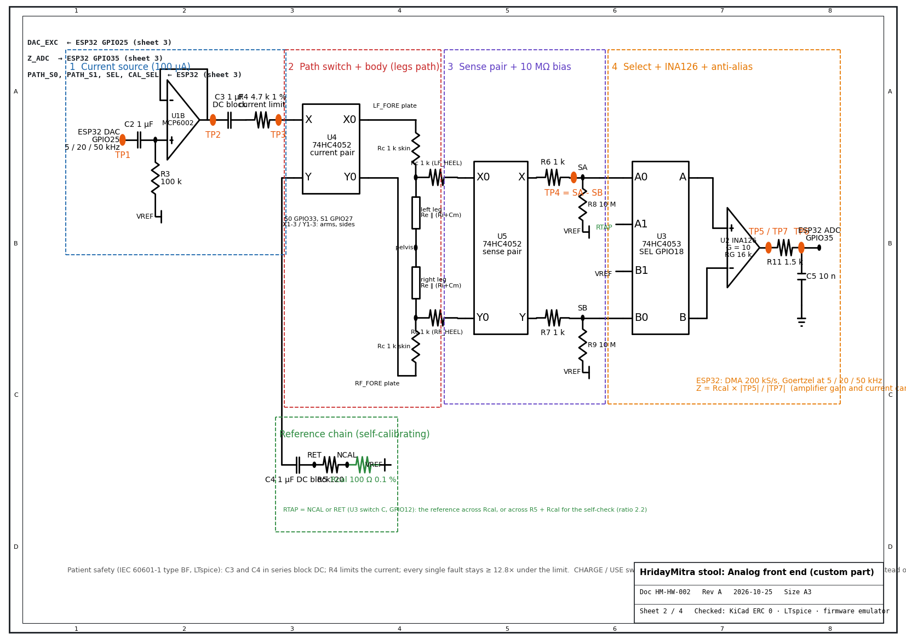
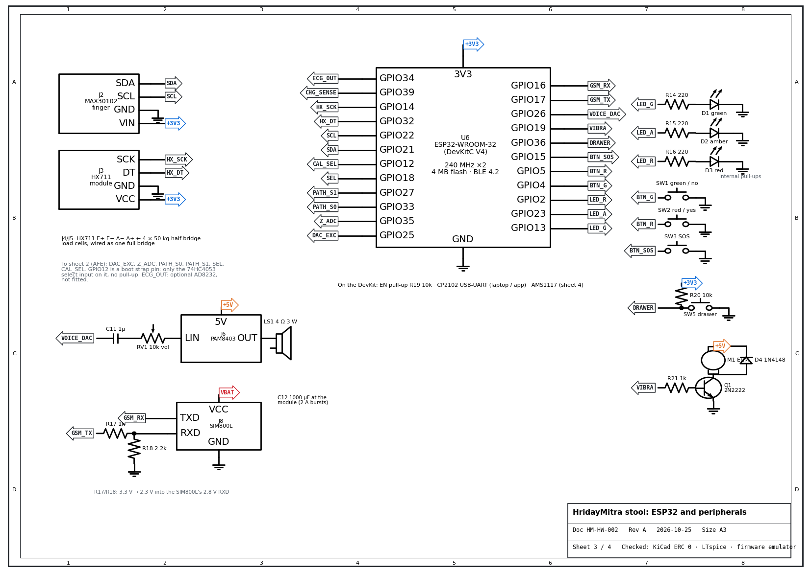
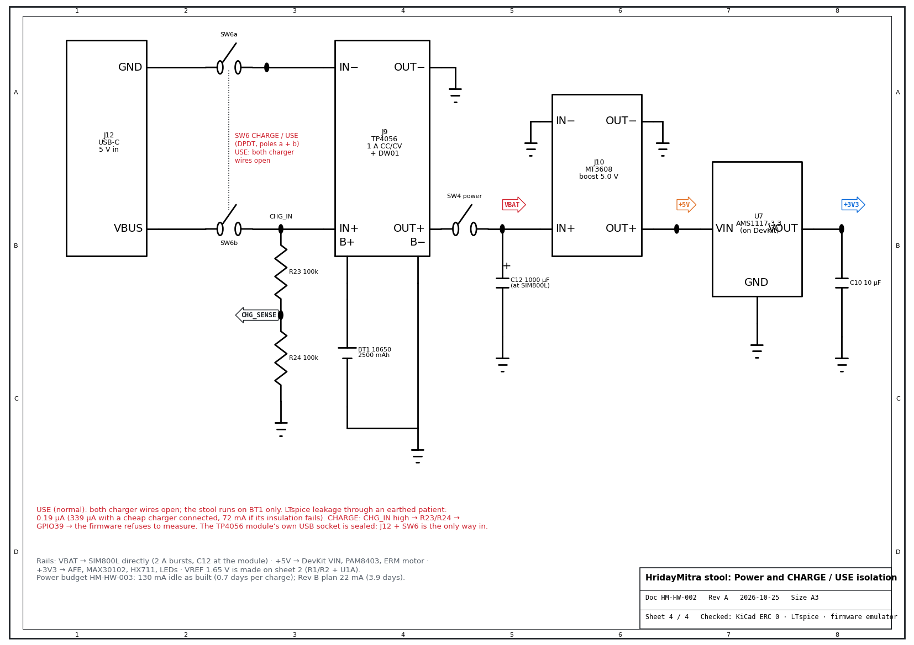
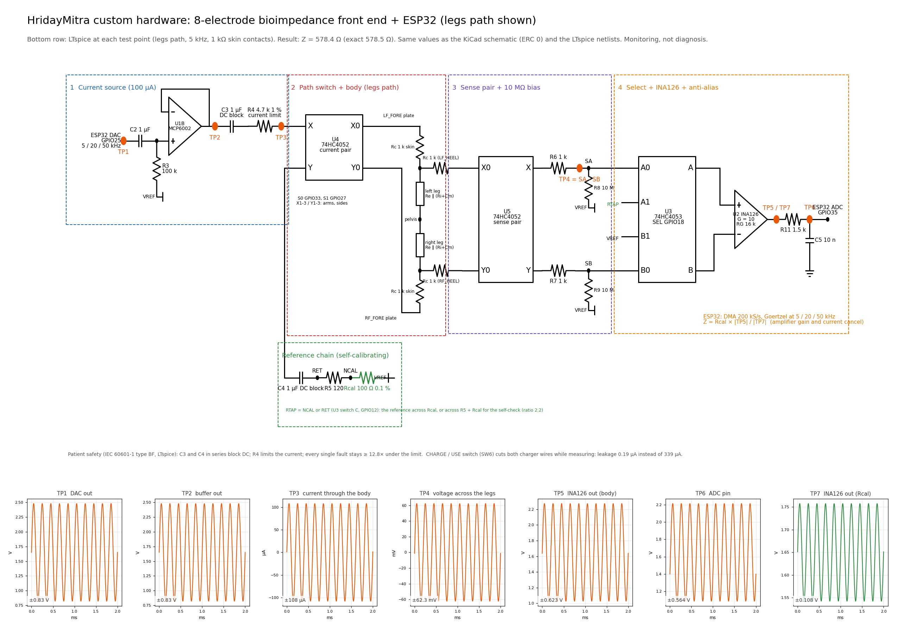
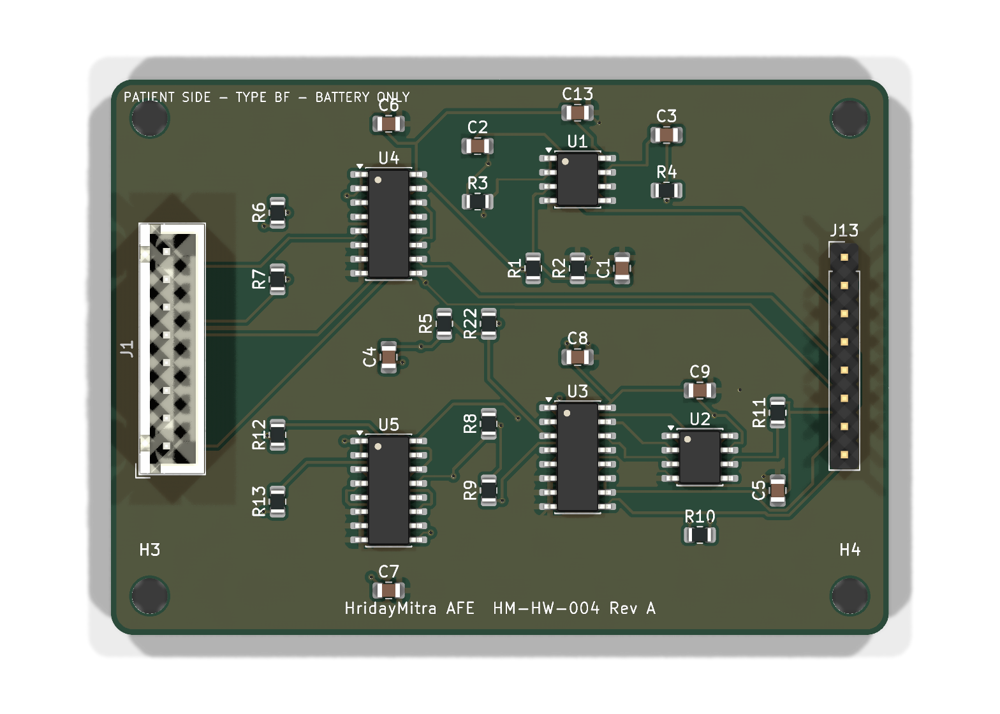
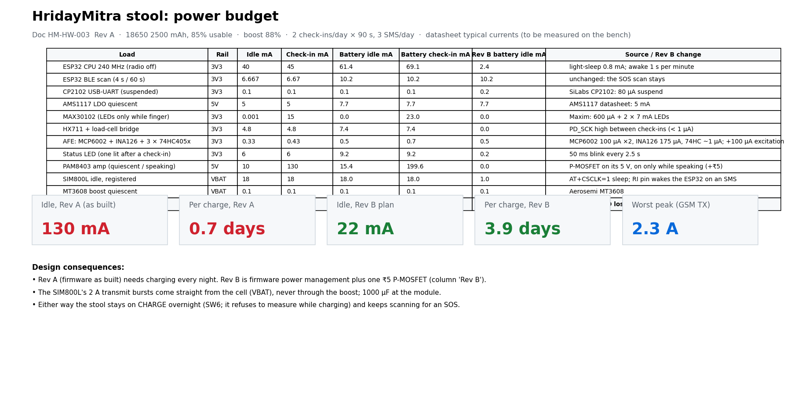

# 1. Hardware design

Everything a judge needs for the hardware score, in one place. Sources and scripts live in [`hardware/`](../hardware/), [`firmware/`](../firmware/) and [`tools/`](../tools/).

| File | What it is |
|---|---|
| [prototype_photo.jpg](prototype_photo.jpg) | Working breadboard unit on a household chair, amulet worn on a cord |
| [HM-HW-001_block_diagram.pdf](HM-HW-001_block_diagram.pdf) | Block diagram: sensors → ESP32 → outputs, power, care loop, failure paths |
| [HM-HW-002_schematics.pdf](HM-HW-002_schematics.pdf) | 4-sheet schematic set (sheet images below) |
| [frontend_sheet.png](frontend_sheet.png) | 8-electrode impedance front end with LTspice test points TP1–TP7 |
| [HM-HW-003_power_budget.pdf](HM-HW-003_power_budget.pdf) | Power budget: current per state, battery life |
| [HM-HW-004_pcb_3d_top.png](HM-HW-004_pcb_3d_top.png) · [Gerbers](pcb_gerbers.zip) | 2-layer 70 × 50 mm PCB of the custom sensor board, fully routed, 0 DRC errors, ready to order |
| [parts_list_and_build_guide.pdf](parts_list_and_build_guide.pdf) | Parts list with INR prices and build steps |
| [cost_report.pdf](cost_report.pdf) | Cost report: **₹4,402** (limit ₹5,000), with store links |

**The custom sensor part:** an 8-electrode bioimpedance front end. ESP32 DAC excitation at 5 / 20 / 50 kHz → MCP6002 current source → 74HC4052 / 74HC4053 path selection → INA126 amplifier → ESP32 ADC, with a built-in 0.1 % reference resistor for self-calibration. Battery only while measuring; never on anyone with a pacemaker or ICD.

