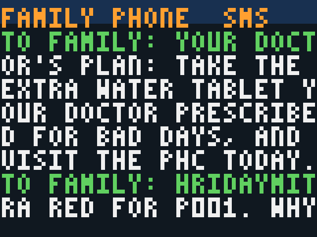
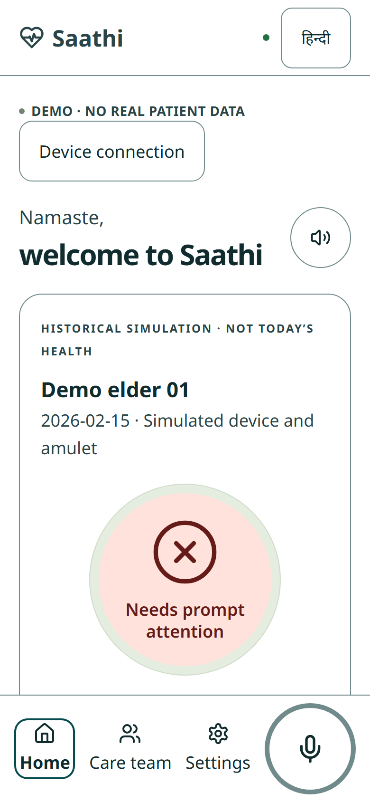
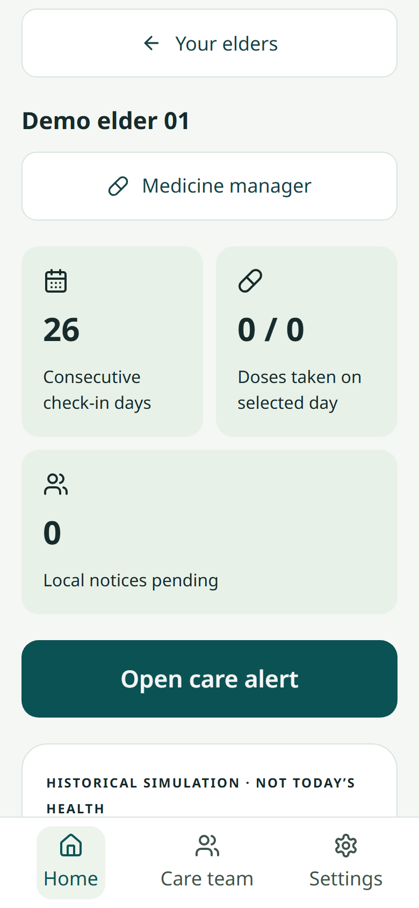
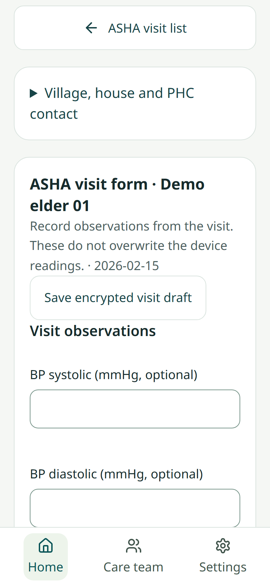
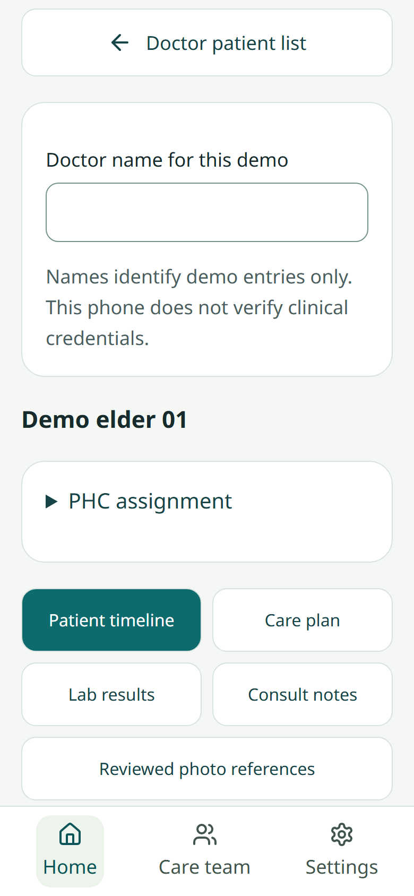

# 2. Software and analytics

Raw sensor signals → quality checks → features → **personal baseline** → green / amber / red **with the reason in words** → SMS and app.

| Piece | Where | What it does |
|---|---|---|
| Signal processing | [engine/signals.py](../source_code/engine/signals.py), [engine/sts.py](../source_code/engine/sts.py) | Goertzel impedance at 3 frequencies, Cole fit, pulse / SpO₂ from PPG, night breathing, walk test, sit-to-stand from platform force; "no reading" when quality is bad |
| Alert engine (rules v3) | [engine/alert_engine.py](../source_code/engine/alert_engine.py) | Baseline = the person's own median of days t−35..t−7; only the worsening direction scores; red needs two body systems to agree |
| Hybrid engine | [engine/hybrid.py](../source_code/engine/hybrid.py), [engine/frozen_hybrid.json](../source_code/engine/frozen_hybrid.json) | Rules propose, a logistic model trained on dev patients only confirms |
| On the device | [engine_core.h](../source_code/firmware/hridaymitra_stool/engine_core.h) | Same engine in C++ on the ESP32, offline; identical to Python on 100 % of 3,231 test days |
| Amulet | [firmware/hridaymitra_amulet/](../source_code/firmware/hridaymitra_amulet/) | Night breathing, night sit-ups, steps, 6-minute walk, falls, SOS |
| Care loop | [sim/careloop/careloop.py](../source_code/sim/careloop/careloop.py) | SMS: family 1 → family 2 (30 min) → ASHA (2 h) → PHC doctor (6 h) |
| Saathi app | [app/](../source_code/app/) | Offline phone app, 10 Indian languages, elder / family / ASHA / doctor screens; same engine in TypeScript |

**A real alert from the firmware emulator** ([reports/sil_sms.jsonl](../source_code/reports/sil_sms.jsonl)):

> HridayMitra RED for P001, no reply yet. Why: leg reading -4 %; weight +1.3 kg; leg water outside cells +1 %. Reply 1 checking, 2 need help, 3 fine.

**How the score works:** each signal is measured in "spread units" from the person's own normal. Signals are grouped into fluid, heart-lungs and daily life; family score = strongest + half of the second; their sum is S. Amber at 0.6 T; red at T on 2 of 3 days with two families agreeing. Oxygen below 90 % is red at once. Full signal table: [main README](../README.md#signals-the-engine-scores).

## Saathi app screens

<table>
<tr>
<td align="center"> <b>Elder</b> one big status, voice in their language</td>
<td align="center"> <b>Family</b> alerts, medicines, check-in streak</td>
<td align="center"> <b>ASHA worker</b> visit list, visit form</td>
<td align="center"> <b>PHC doctor</b> timeline, care plan, labs, notes</td>
</tr>
</table>

*Demo data on a simulated red-alert day (synthetic patient). Screens captured by `../source_code/app/tools/screenshots.mjs`.*

