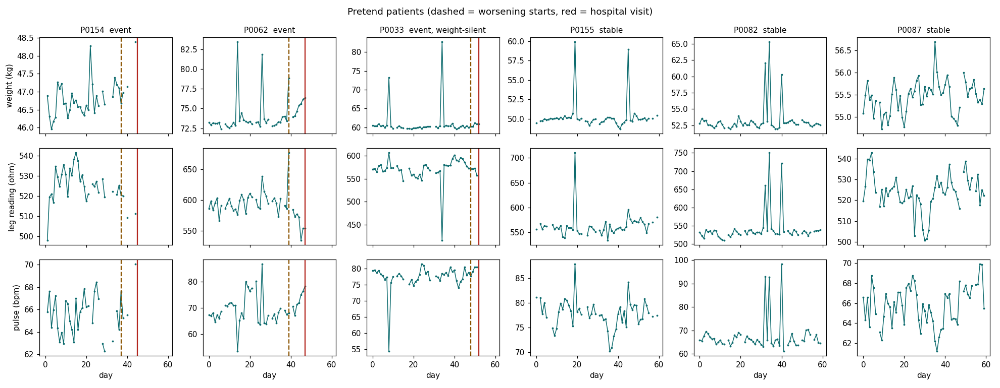

# 3. Data

All patient data is **synthetic** (computer-generated), as the problem statement asks. No human data was collected. Real public data (PhysioNet BIDMC) is used only to check the heart-rate, pulse and breathing code.

| File | What it is |
|---|---|
| [dataset_card.md](dataset_card.md) | How the patients are built: every parameter with its published source, or marked ASSUMPTION |
| [sample_two_patients.csv](sample_two_patients.csv) | Daily device readings for one stable patient (P0001) and one who worsens and is admitted (P0002) |
| [patients_sample.png](patients_sample.png) | Example patients: signals drifting in the 3–10 days before the hospital visit |
| [measurement_error_model.png](measurement_error_model.png) | How sensor noise and bad readings are added |

## All datasets (14 sets, 1,600 synthetic patients, 68 real PhysioNet recordings)

| # | Folder | Patients (events) | Used for | Files |
|---|---|---|---|---|
| 1 | [1_main_200_patients/](1_main_200_patients/) | 200 (120), 60 days each, seed 42 | Tuning (dev, 140) and the held-out test (60) | `daily_features.csv` (device readings, one row per patient-day), `patients.csv`, `labels.csv` (answer key), `truth_daily.csv` (hidden truth, never shown to the engine), **`alerts.csv`** (light, score per body system, reason and likely cause for every patient-day) |
| 2 | [2_external_1000_patients/](2_external_1000_patients/) | 1,000 (100), seed 43, a rarer, "real-world-like" event rate | External test, never used for tuning | same files |
| 3 | [3_stress_weak_leg_signal/](3_stress_weak_leg_signal/) | 200 (120) | Worst-case assumption: the leg reading responds only half as much to fluid | same files |
| 4–12 | [4_stress_real_life/](4_stress_real_life/) | 400 (100) from set 2, **9 messy versions** | Real-life stress tests behind [stress_and_ablation.csv](../04_Testing_and_Validation/stress_and_ablation.csv) | `clean_before_stress.csv` and one file per case: 30 % and 50 % days missing, 10 % guest days, 15 % wet-feet days, amulet worn half the time, power cuts / travel gaps, electrode ageing 1 % and 3 % a month, everything bad at once |
| 13 | [data/raw/ `bidmc_chf_*`](../data/raw/) | 15 real heart-failure patients (PhysioNet BIDMC CHF) | Heart rate from ECG | 30-minute ECG excerpts |
| 14 | [data/raw/ `bidmc_ppg_*`](../data/raw/) | 53 real ICU patients (PhysioNet BIDMC PPG and Respiration) | Pulse from finger PPG, breathing rate | PPG, breathing signal, monitor pulse, annotated breaths |

All synthetic sets are rebuilt with one command each (same seed → same files): `python sim/patients/make_patients.py`, `python tools/export_stress_sets.py`, `python tools/export_alerts.py`. Real PhysioNet data is public and downloaded by the validation scripts.

## Scripts that build and analyse the data

| Step | Script | What it does |
|---|---|---|
| 1. Build patients | [sim/patients/make_patients.py](../sim/patients/make_patients.py) | Generates the synthetic patients from the parameters in [dataset_card.md](dataset_card.md) |
| 2. Check the data | [sim/patients/check_patients.py](../sim/patients/check_patients.py) | Prints simple facts about the patients and draws 6 of them (`patients_sample.png`) |
| 3. Sensor noise | [sim/circuit/measurement_error_model.py](../sim/circuit/measurement_error_model.py) | Turns LTspice and bench numbers into the noise added to every reading |
| 4. Alert engine | [engine/alert_engine.py](../engine/alert_engine.py), [engine/hybrid.py](../engine/hybrid.py) | Personal baseline, scores, lights, reasons |
| 5. Day-by-day output | [tools/export_alerts.py](../tools/export_alerts.py), [tools/export_stress_sets.py](../tools/export_stress_sets.py) | Writes `alerts.csv` and the 9 stress datasets above |
| 6. Benchmark | [benchmark/bench.py](../benchmark/bench.py), [benchmark/score.py](../benchmark/score.py) | Splits patients, tunes on dev only, scores once on test / external / stress with bootstrap ranges |
| 7. Robustness | [engine/assumption_sensitivity.py](../engine/assumption_sensitivity.py), [engine/stress_and_ablation.py](../engine/stress_and_ablation.py) | Pushes every assumption to its extremes; removes one part at a time |
| 8. Real public data | [engine/validate_bidmc_hr.py](../engine/validate_bidmc_hr.py), [engine/validate_bidmc_ppg.py](../engine/validate_bidmc_ppg.py) | Heart rate, pulse and breathing code on PhysioNet BIDMC |

**Problem-statement rules met:** at least 20 patients × 30 days (we use 200 × 60, plus 1,000 external); worsening starts 3–10 days before the visit; each patient is fully in training or testing ([benchmark/splits.json](../benchmark/splits.json)).

