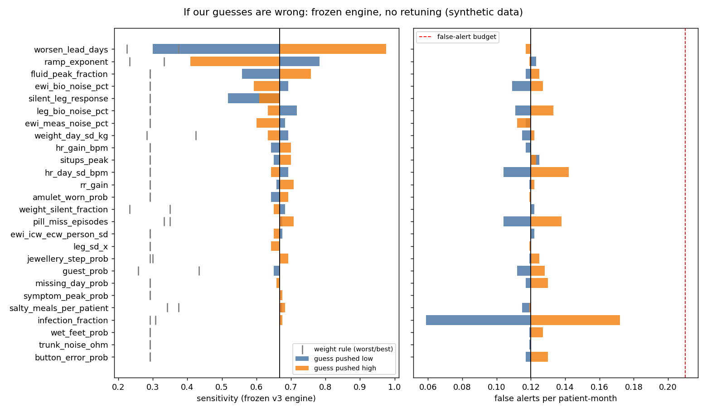
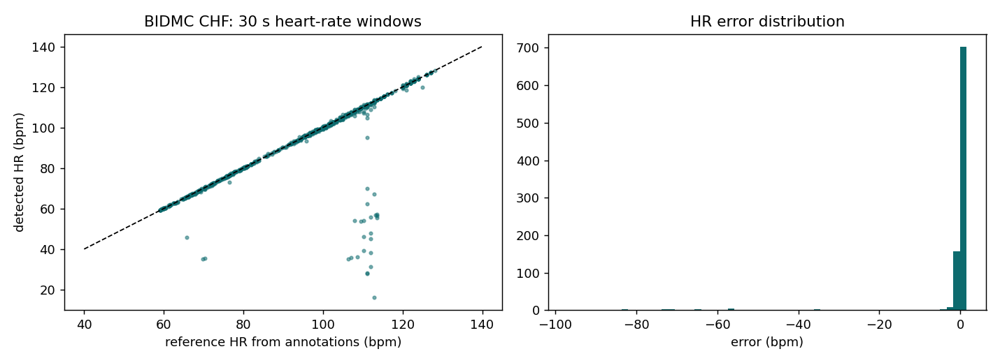

# 4. Testing and validation

## The four measures the problem statement asks for

Hybrid engine, tuned on dev patients only, scored once on held-out patients ([leaderboard.md](leaderboard.md)):

| Set | Sensitivity | Specificity | Median lead time | False alerts / patient / month |
|---|---|---|---|---|
| Test (60 patients, 35 events) | **86 %** [73–95] | **97.9 %** | **3 days** | **0.19** [0.08–0.30] |
| External (1,000 patients, 100 events) | **86 %** [79–93] | **99.0 %** | **3 days** | **0.09** |
| Weight rule, SCALE-HF (current standard), test | 40 % [25–57] | 97.6 % | 2 days | 0.53 |

Brackets: 95 % range from 1,000 bootstrap resamples of patients.

## Is it just learning our own simulator?

| File | What it shows |
|---|---|
| [assumption_sensitivity.csv](assumption_sensitivity.csv) · [assumption_tornado.png](assumption_tornado.png) | Every modelling assumption pushed to both extremes: always within the false-alert budget, always beats the weight rule |
| [stress_and_ablation.csv](stress_and_ablation.csv) | Missing days, power cuts, guests, wet feet, electrode ageing; and removing one part at a time (no amulet → 54 %, weight alone → 1 %) |

## Real public data (PhysioNet)

| Check | Result | File |
|---|---|---|
| Heart rate from ECG, BIDMC CHF (15 patients) | 2.1 bpm mean error, 96 % of windows within 5 bpm | [bidmc_hr_summary.json](bidmc_hr_summary.json) · [plot](bidmc_hr_validation.png) |
| Pulse from finger PPG, BIDMC PPG (53 patients) | 0.91 bpm median error | [bidmc_ppg_summary.json](bidmc_ppg_summary.json) |
| Breathing rate, amulet method | 1.0 breath/min median error | [bidmc_ppg_summary.json](bidmc_ppg_summary.json) |

## Automated tests

| Suite | Count | Where |
|---|---|---|
| Python (engine, signals, benchmark, C++ = Python parity) | 67 | [tests/](../tests/), run `pytest` |
| App (engine vectors, screens, languages) | 109 | [app/tests/](../app/tests/), run `npm test` in `app/` |
| Firmware emulator (real .ino code, mocked sensors) | 41 checks | [tests/sil/](../tests/sil/) |

**Limits:** synthetic patients show the method works on the patterns we modelled; this is not clinical accuracy. Monitoring, not diagnosis.

