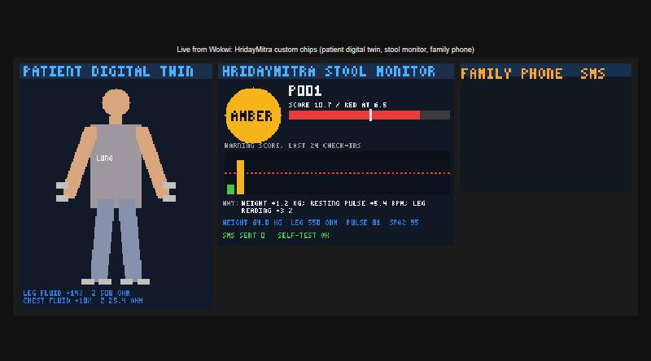
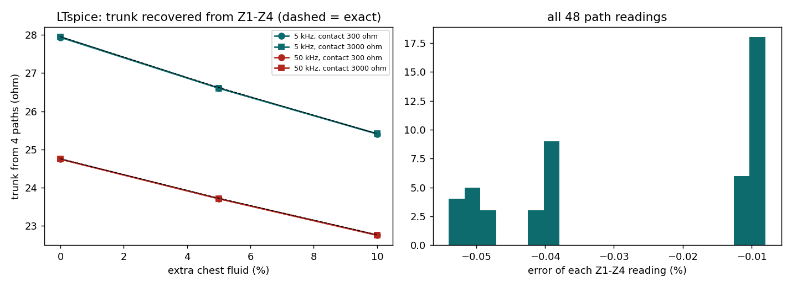
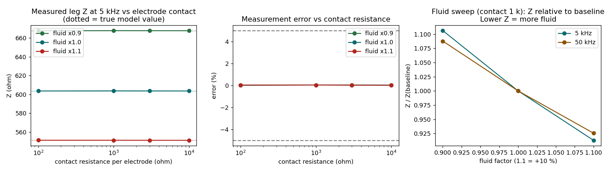
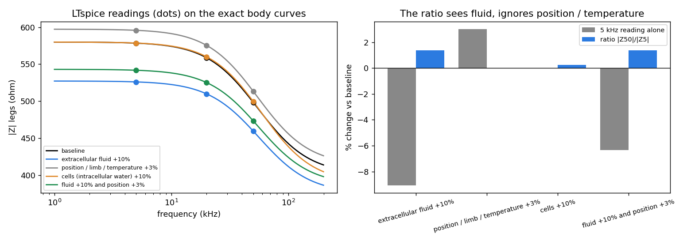
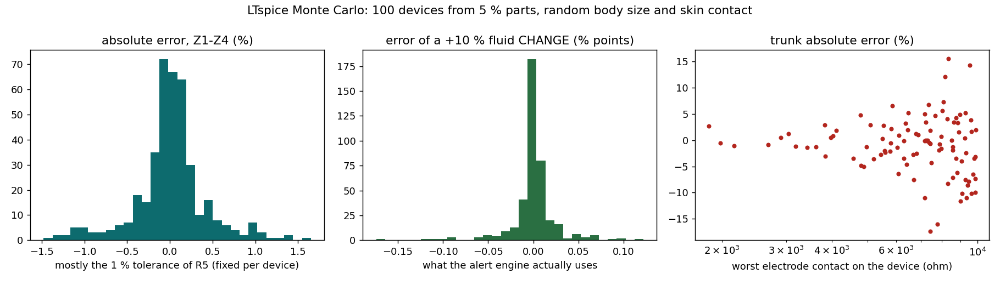

# 5. Simulation proof

| Tool (free) | What it proves | Open it |
|---|---|---|
| **Wokwi** (browser) | The real ESP32 firmware running: check-in, alert engine, lights, SMS | **[wokwi.com/projects/478945371100594177](https://wokwi.com/projects/478945371100594177)** · sources in [wokwi/](../wokwi/) |
| Demo video | One patient month in the simulator, with the circuit panel and SMS | [simulation_demo.mp4](../Deliverables/simulation_demo.mp4) |
| **LTspice** | The impedance front end reads legs, arms and chest within 0.04 % of the exact value; contact resistance cancels; +10 % leg fluid shows as −8.7 % | [sim/circuit/](../sim/circuit/) · [check it yourself in 10 minutes](../sim/circuit/HOW_TO_VERIFY.md) |
| LTspice Monte Carlo | How part tolerances spread the reading (why the built-in reference resistor is needed) | [montecarlo.png](montecarlo.png) |
| Spectroscopy | 5 / 20 / 50 kHz Cole fit: water outside cells within 0.6 % | [spectroscopy.png](spectroscopy.png) |
| Firmware emulator (SIL) | The same `.ino` compiled on a PC with mocked sensors, BLE and SIM800L: 41 checks pass | [tests/sil/](../tests/sil/) |
| KiCad + Freerouting | Fully routed PCB, 0 DRC errors | [01_Hardware_Design](../01_Hardware_Design/) |

