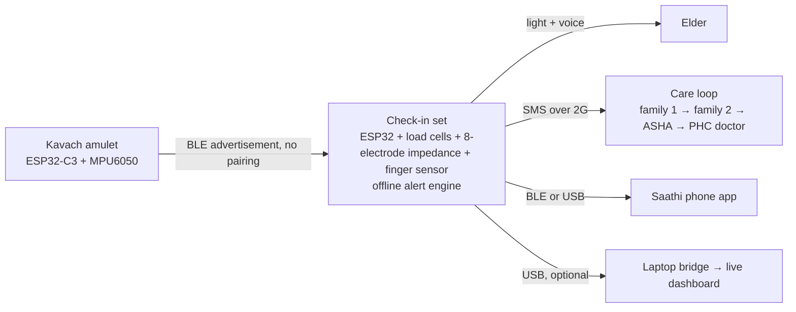
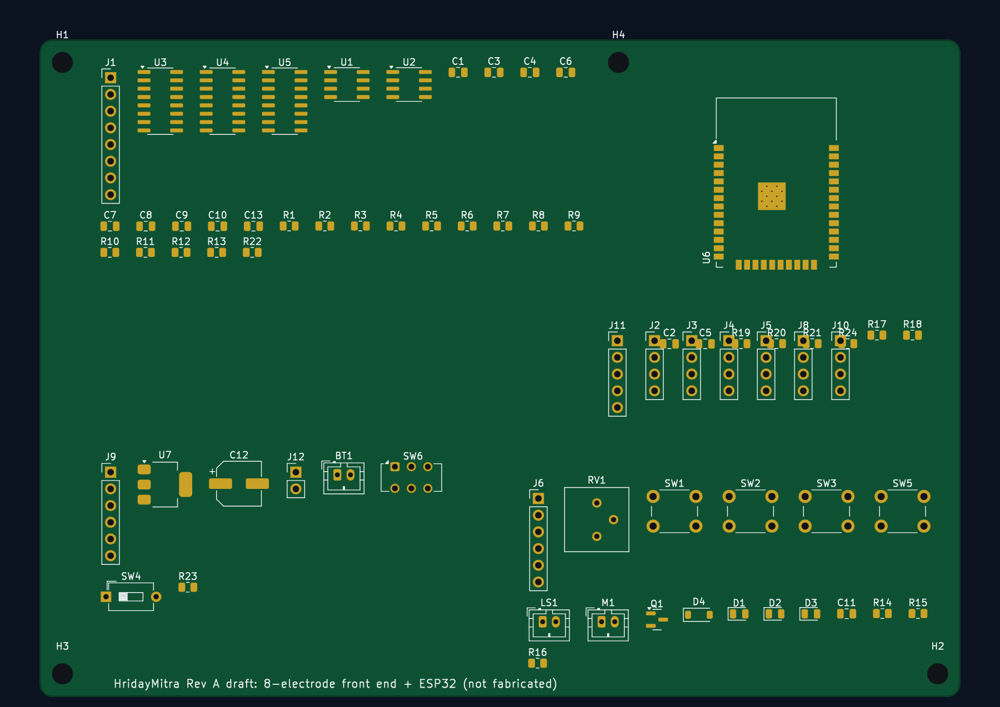

# HridayMitra: early warning of worsening heart failure at home

[](https://github.com/aadityaa0523/HridayMitra/actions/workflows/tests.yml)


> **Monitoring, not diagnosis.** Research prototype for the Transfinitte 2026 hackathon (hardware track, problem statement by Dare 2 Dream Ventures).
> All patient data in this repository is **synthetic** (plus public PhysioNet BIDMC ECG for heart rate). No human data was collected.

**In one line:** a 90-second daily check-in on the patient's own chair, an amulet, and an offline alert engine that warns the family **days before** a heart-failure hospital visit (up to **4 days** in our worked example, median 3), for a build cost of about **₹4,400**.

**Jump to:** [The problem](#the-problem-and-the-idea) · [How it works](#how-it-works) · [Results](#results) · [Quick start](#quick-start) · [Saathi phone app](#saathi-phone-app) · [Hardware and firmware](#hardware-and-firmware) · [Simulate it](#simulate-it-no-hardware) · [Reproduce](#reproduce-everything) · [Repository map](#repository-map) · [Documents](#documents) · [Troubleshooting](#troubleshooting) · [Honest limits](#honest-limits)

---

## The problem and the idea

Fluid builds up silently for days before a heart-failure admission. A daily weight rule catches about one event in three and floods families with false alarms. Elders will not wear sticky patches, and rural homes have power cuts, 2G and low literacy.

HridayMitra measures what a weight scale cannot (fluid in the legs and chest) in the way an elder will actually accept (sit down, hands on a bar), learns each person's *own* normal, and tells the family **why** it raised an alert, by SMS, with no internet.

| Part | What it is | What it measures |
|---|---|---|
| **Check-in set** | A weighing platform under the patient's own chair (4 load cells, 4 stainless foot plates) plus a hand sensor bar (4 hand strips, fingertip optical cradle, ✓ / ✗ / SOS buttons, speaker, status light). No chair modification; never on wheeled chairs. | Weight; 8-electrode bioimpedance spectroscopy at 5 / 20 / 50 kHz (legs, arms, both sides → chest fluid by segmental subtraction; water outside the cells from a Cole-model fit, which cancels foot position and skin temperature); pulse and SpO₂; sit-to-stand speed from the platform's force; 3 spoken yes/no questions |
| **Kavach amulet** | ESP32-C3 + accelerometer on a breakaway cord, no magnets | Night breathing, night sit-ups, activity, a weekly 6-minute walk test (it finds the best 6 minutes itself, no button), falls, SOS |
| **Offline alert engine** | Runs on the ESP32 | Personal baseline, green / amber / red, reasons in plain words |
| **Care loop** | SMS over 2G with retries | family 1 → family 2 (30 min) → ASHA worker (2 h) → PHC doctor (6 h) |
| **Saathi app** | Offline PWA, 10 Indian languages | Elder, family, ASHA and doctor views |

## How it works



**The alert engine** (`engine/alert_engine.py`): each person's baseline is the median/MAD of their own days t−35..t−7. Only the worsening direction is scored. Red needs **two independent witnesses** (for example weight and leg fluid), and bad-data guards ignore guests on the platform, a toe ring bridging two plates, lifted feet and noisy fingers. The same engine exists three times and is held identical by tests:

| Where | File | Checked by |
|---|---|---|
| Python (research, dashboard) | `engine/alert_engine.py` | reference |
| C++ on the ESP32 | `firmware/hridaymitra_stool/engine_core.h` | `tests/test_engine_parity.py`: 100% of 3,231 days |
| TypeScript in the app | `app/src/engine/` | `app/tests/engine.test.ts` against `docs/app/engine_test_vectors.json` (2,732 comparisons) |

**Hybrid engine** (`engine/hybrid.py`): rules propose, a 13-weight logistic model trained on dev only must agree before red. It runs on the laptop and in the benchmark; the stool itself runs rules v3.

## Results

Synthetic cohorts; thresholds tuned on training patients, frozen, then tested once.

| | Rules engine v3 | Hybrid (rules + ML) | Weight rule (SCALE-HF) |
|---|---|---|---|
| Sensitivity, held-out patients | **66%** | **86%** | 40% |
| Sensitivity, external 1,000-patient cohort | **72%** | **86%** | 31% |
| Specificity (held-out) | 98.7% | 97.9% | 97.6% |
| False alerts per patient-month (held-out / external) | **0.06 / 0.06** | 0.19 / 0.09 | 0.53 / 0.38 |
| Median lead time before the visit | 3 days | 3 days | 2 days |

Full tables with 95% ranges and an open scorer anyone can run: [`benchmark/LEADERBOARD.md`](benchmark/LEADERBOARD.md), [`benchmark/README.md`](benchmark/README.md).

- **Calibrated to real trials.** The published FAST and SCALE-HF 1 weight rules score on our external cohort 20% / 33% caught and 4.8 / 4.85 unexplained alerts per year, against the published 23% / 35% and 4.3 / 4.18.
- **Robust.** It beats the weight rule in all 52 assumption-sensitivity scenarios and 14 of 15 stress cases. In the 15th (10% guest days) the rule catches more but fires about 30× more false alerts.
- **Care loop.** In simulation 92% of red alerts get a clinical review before the hospital visit, versus 27% with a single SMS.
- **Circuit.** LTspice puts every path within 0.05% of the exact answer. A Monte Carlo of 100 stools built from 5% parts keeps 99% of readings within 2%, and it found a real design bug (bias resistors 1 MΩ → 10 MΩ).
- **Heart rate on real ECG.** All 15 PhysioNet BIDMC CHF records: median error 0.15 bpm, 13 of 15 within 0.5 bpm. It fails on chf12, a very noisy recording.
- **Cost.** Parts list ₹3,917 (low) to ₹4,890 (plan price). Monte Carlo of price noise: median ₹4,402, 5th–95th percentile ₹4,319–4,486. Build cost only, no shipping.
- **Firmware.** The whole firmware runs through an emulated month: 26/26 claims pass and every light equals the Python engine.

Details: `reports/phase1_summary.md`, `reports/phase2_summary.md`, `sim/circuit/HOW_TO_VERIFY.md`, [`docs/EVIDENCE.md`](docs/EVIDENCE.md) (every problem-statement requirement → proof file, plus a failure-modes table).

## Quick start

Requires Python 3.11.

```bash
python run.py setup     # install packages, generate the synthetic cohorts if missing
python run.py test      # pytest suite, incl. the real firmware in an emulated month and C++ engine = Python engine
python run.py demo      # dashboard: patient light + voice, family SMS, ASHA/doctor trends, "break it" switches
```

| What you want | Command |
|---|---|
| Watch a pretend patient arrive live in the dashboard (no hardware) | `python run.py live --simulate P0022`, then `python run.py demo` → "Live stool" |
| Compile both boards (needs `arduino-cli` with the esp32 core) | `python run.py firmware` |
| Flash the stool (COM5) and the amulet (COM6) | `python run.py firmware --upload COM5 --amulet-port COM6` |
| Log the real stool's check-ins into the dashboard | `python run.py live --port COM5` |
| Prove the real stool decides exactly like the tested engine | `python run.py hil --port COM5` |
| Simulate the whole stool in Wokwi | `python run.py wokwi`, then `wokwi/README.md` |
| Re-run every result / rebuild every document | `python run.py reproduce` / `python run.py docs` |
| Everything | `python run.py all` |

In the dashboard, try patient **P0022**: slide to the red day, then tick "guest" and "toe ring" and watch the light refuse to lie.

## Saathi phone app

`app/` is **HridayMitra Saathi**: an offline-first PWA (React 18 + TypeScript + Vite, Tailwind, Workbox, Dexie) for one Android phone with role switching.

- **Elder mode:** big status orb, voice commands (offline Vosk packs), medicine reminders, a cancellable two-step emergency button that only opens the dialler.
- **Family:** trends, alerts, medicines, adherence, care contacts. **ASHA:** prioritised visit list, referral PDF and QR, weekly PHC summary. **Doctor:** timeline, care plan versions, labs, consult notes, sensitivity what-if.
- **Reports:** nine English/Hindi PDF formats, FHIR R4 JSON export, offline animated-QR transfer.
- **Device link:** BLE GATT or Web Serial to the stool (same JSON protocol as `firmware/hridaymitra_stool/app_link.h`), plus a built-in simulator.
- **Privacy:** records are encrypted at rest (AES-GCM, PBKDF2 PIN key). PINs are a demo mechanism, not production authentication.
- **Languages:** 10 UI languages (extra ones flagged "machine-translated, needs review"); light, dark and high-contrast themes; 48 pre-generated Hindi audio clips.
- **Verified:** 108 unit tests, 27 browser tests, mobile Lighthouse accessibility 100 (see `docs/app/PHASE_9.md`).

```bash
cd app
python ../tools/prepare_voice_models.py   # optional: 82 MB voice packs, not in git
npm ci && npm test && npm run dev
```

Node.js 22.12+. End-to-end tests: `npm run test:e2e` (Playwright, Pixel 5 viewport).

### Install it on a phone

A PWA installs only from **HTTPS or `localhost`**; plain `http://<lan-ip>` does not work.

**Option A: host it.** `cd app && npm ci && npm run build`, then upload `app/dist/` to the **root** of a static host (Netlify Drop, or Vercel / Cloudflare Pages with root directory `app`, build `npm run build`, output `dist`). The app uses root-absolute paths (`/models/`, `/audio/`), so it cannot sit under a sub-path such as GitHub Pages `/HridayMitra/`. On the phone: Android Chrome → menu → *Install app*; iPhone Safari → Share → *Add to Home Screen*.

**Option B: USB, no hosting (Android).** Enable *Developer options → USB debugging*, connect the phone, then:

```bash
cd app && npm ci && npm run build
npm run preview -- --port 4173          # serves the production build
adb reverse tcp:4173 tcp:4173           # in a second terminal
# phone: Chrome → http://localhost:4173 → menu → Install app
```

Open the installed app once while connected and wait for "App ready offline"; it then works without the cable. Web Bluetooth pairing needs Chrome on Android (not iOS). Per-phase details: `app/README.md`, `docs/app/PHASE_*.md`.

## Hardware and firmware

| Path | Contents |
|---|---|
| `firmware/hridaymitra_stool/` | ESP32 DevKit. 90 s check-in, HX711 weight (one HX711 for all four cells), 4 impedance paths with Goertzel, MAX30102 pulse/SpO₂, 3 questions, sit-to-stand fit, amulet scan, **the alert engine on the chip** (`engine_core.h`), SMS ladder with retries, replies and missed calls, engine state in flash, daily self-test, CHARGE / USE safety switch. Phone numbers and timings are in `config.h`. |
| `firmware/hridaymitra_amulet/` | ESP32-C3 + MPU6050. Night breathing, sit-ups, activity, 6-minute walk (`walk_core.h`), falls, SOS, sent in the BLE advertisement (no pairing). |
| `hardware/kicad/` | KiCad 9 schematic generated from code (ERC 0), netlist, PDF, and the Rev A PCB placement (`hridaymitra_pcb_unrouted.kicad_pcb`, Specctra `hridaymitra_pcb.dsn`). |
| `docs/hardware/` | HM-HW-001 block diagram, HM-HW-002 schematic set, HM-HW-003 power budget, HM-HW-004 PCB placement, system architecture, front-end sheet with LTspice test points. |
| `sim/circuit/` | LTspice netlists, Monte Carlo of 100 devices, mains-hum test, spectroscopy, self-calibration, IEC 60601-1 fault analysis, charger leakage. |

### PCB design (Rev A draft)



A 2-layer, 140 × 100 mm board for the custom part (8-electrode front end + ESP32), made by `tools/make_pcb.py` from the same netlist as the KiCad schematic: every part gets a footprint, parts are grouped by function (analog front end and electrode header top-left, ESP32 with its antenna at the top edge, module headers on the right, power and the CHARGE / USE switch bottom-left, buttons, LEDs and drivers bottom-right) and four M3 mounting holes. The script writes a Specctra DSN for autorouting (Freerouting) and, given the routed `.ses`, adds the tracks, pours ground on both layers and runs DRC.

Status: **placement only, routing next. Not fabricated, not yet reviewed by a layout engineer.**

```bash
python3 tools/make_pcb.py                       # needs KiCad 7+ (pcbnew Python module + footprint library)
java -jar freerouting-1.9.0.jar -de hardware/kicad/hridaymitra_pcb.dsn -do routed.ses
python3 tools/make_pcb.py routed.ses            # tracks + ground pour + DRC report
```

Safety design: two series coupling capacitors plus a current-limit resistor (every single fault within IEC 60601-1 type-BF limits, margin ≥ 12.8×), battery-only measuring, a CHARGE / USE switch that cuts both USB wires, impedance and ECG switchable off for pacemaker / ICD users.

Voice prompts: `python tools/make_voice_clips.py`. Recorded Hindi / Tamil WAVs in `firmware/voice/<lang>/` replace the built-in English voice.

## Simulate it (no hardware)

- **Wokwi** (`wokwi/`): the production firmware on an emulated ESP32 with a *virtual patient* chip (drag leg fluid, chest fluid, lifted foot, mains hum), a MAX30102 chip, a monitor chip showing the engine's decision, and a SIM800L chip with a phone screen that receives the SMS ladder. Build with `python run.py wokwi`; run in the browser in two minutes, see [`wokwi/README.md`](wokwi/README.md).
- **Software-in-the-loop** (`tests/test_firmware_sil.py`, `tests/sil/`): the same firmware compiled for the laptop and driven through a month.
- **Demo video:** [`docs/demo/hridaymitra_month_demo.mp4`](docs/demo/hridaymitra_month_demo.mp4), one month of the stool firmware driving the Wokwi screens.

## Reproduce everything

| Step | Command |
|---|---|
| Synthetic patients (PS cohort, 200 × 60 days) | `python sim/patients/make_patients.py` |
| Real-world cohort (1,000 × 180 days) | `python sim/patients/make_patients.py --patients 1000 --days 180 --event-fraction 0.1 --seed 43 --out data/processed/realworld` |
| Tune on training patients, freeze, test once | `python engine/leadtime_v2.py` |
| Stress tests and ablations | `python engine/stress_and_ablation.py` |
| Assumption sensitivity | `python engine/assumption_sensitivity.py` |
| Published-trial calibration | `python engine/calibrate_published.py` |
| ML comparator, hybrid engine, benchmark | `python engine/ml_comparator.py`, `python engine/hybrid.py`, `python benchmark/bench.py` |
| Score your own method | `python benchmark/score.py my_submission.csv test` |
| Care-loop simulator | `python sim/careloop/careloop.py` |
| Heart rate on PhysioNet BIDMC CHF | `python engine/validate_bidmc_hr.py` |
| LTspice: legs, chest paths, Monte Carlo, hum (needs LTspice) | `python sim/circuit/trunk_paths.py`, `montecarlo.py`, `hum.py` |
| KiCad schematic + ERC + netlist checks (needs KiCad 9) | `python tools/make_schematic.py` |
| Block diagram, cost simulation | `python tools/make_block_diagram.py`, `python tools/cost_sim.py` |

Every synthetic-patient parameter carries a source or is marked ASSUMPTION in [`data/processed/DATA.md`](data/processed/DATA.md); each ASSUMPTION was pushed low and high in the sensitivity sweep.

## Repository map

| Folder | What is inside |
|---|---|
| `engine/` | `signals.py` (raw → numbers), `alert_engine.py` (baseline, scores, lights, reasons), `hybrid.py`, `product.py` (sick-day plan, coaching, two users, FHIR), `sts.py` (sit-to-stand), `evaluate.py` (the four PS measures, no-peeking check), baselines, tuning scripts, frozen thresholds |
| `benchmark/` | Open benchmark v2: fixed splits with sha256, public scorer with bootstrap ranges, 5 baselines, leaderboard |
| `sim/patients/` | Synthetic patient generator |
| `sim/circuit/` | LTspice netlists and analyses |
| `sim/careloop/` | alert → family → ASHA → doctor simulator |
| `firmware/` | Stool (ESP32) and amulet (ESP32-C3) sketches |
| `hardware/kicad/` | Schematic, ERC report, netlist |
| `wokwi/` | Wokwi projects and custom chips |
| `app/` | Saathi PWA |
| `demo/` | Streamlit dashboard |
| `tools/` | Generators for documents, schematics, voice clips, Wokwi projects, stool bridge, cost simulation, `progress.py` |
| `tests/` | pytest suite plus C++ parity checks |
| `data/` | Synthetic cohorts and public BIDMC ECG |
| `reports/` | All results (CSV, PNG, summaries) |
| `docs/` | Report, pitch, build guide, wiring guide, evidence, decisions, app phase docs |
| `research_notes/` | Background research that shaped the design |
| `progress.json` | Workstream progress, rendered by `tools/progress.py` |

## Documents

- `docs/HridayMitra report.pdf` (2 pages) and `docs/HridayMitra pitch deck.pdf`, plus `docs/PITCH_SCRIPT.md`; regenerated from live results by `python run.py docs`.
- [`docs/EVIDENCE.md`](docs/EVIDENCE.md): requirement traceability, failure modes and safeguards, assumption ledger.
- [`docs/DECISIONS.md`](docs/DECISIONS.md): starting ideas, every design decision with evidence, next improvements.
- Build guide v3, wiring guide, physical build pack, user journey storyboard, block diagram: `docs/`.

## Troubleshooting

| Problem | Fix |
|---|---|
| Imports fail in `python run.py test` | Use Python 3.11, then `python run.py setup` |
| `npm run build` complains about missing `/models/*.bin` | `python tools/prepare_voice_models.py` (downloads and checks sha256) |
| "Install app" not offered on the phone | Not HTTPS / localhost, or first load unfinished; reload and wait for "App ready offline" |
| Phone cannot reach `localhost:4173` | Re-run `adb reverse tcp:4173 tcp:4173`; check `adb devices` lists the phone |
| No Bluetooth button in the app | Use Chrome on Android; iOS Safari has no Web Bluetooth |
| Firmware compile or upload fails | Install the `esp32` core for `arduino-cli`; check the COM port; hold BOOT while flashing if the board does not enter download mode |

## Honest limits

- **Synthetic data.** Patients are synthetic and calibrated to published weight-rule results. This shows the method works on the patterns we modelled; it is not clinical accuracy.
- **Lead time.** The 2–3 day lead is mostly set by how worsening is defined (3–10 days, speeding up at the end). The sweep shows this matters more than any hardware assumption.
- **Chest reading.** A weak signal: a +10% change stands out only after about a week of averaging, so it supports the leg and weight readings.
- **Untested on people.** The circuit is simulated with a textbook body model and not yet compared with a bench build. SpO₂ calibration is generic.
- **App.** Not installed or verified on a physical Android phone; draft translations and audio need human review; alarms need the app open; SMS from the app is a draft only.
- **Safety.** Never use on anyone with a pacemaker or ICD, and measure on battery only while a person touches the electrodes.

## License

[MIT](LICENSE). The medical-safety limits above still apply: this is a research prototype, not a medical device.
